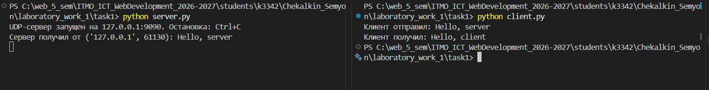
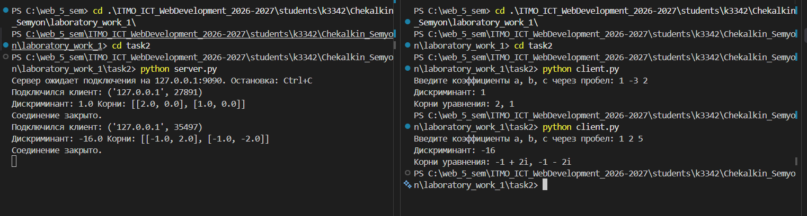
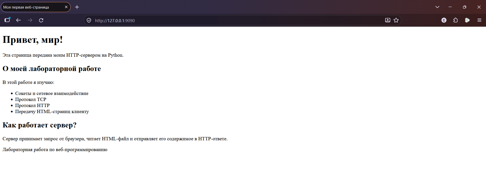
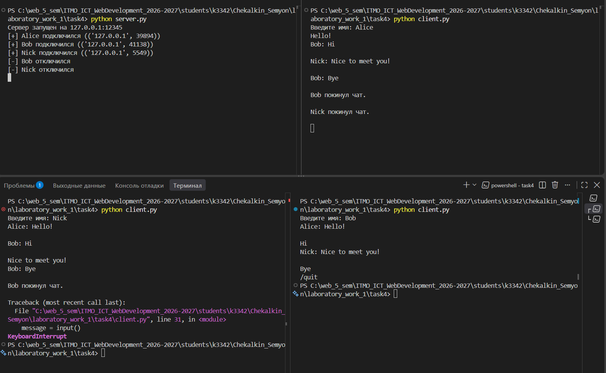
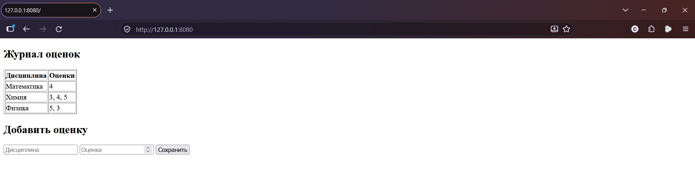

# Лабораторная работа 1. Работа с сокетами

Цель работы - изучение принципов межсокетного взаимодействия и реализация базовой архитектуры клиент-сервер с помощью библиотеки `socket`.

## Задание 1. Обмен сообщениями по UDP

Протокол UDP не устанавливает соединение, сообщение отправляется методом `sendto()` сразу на адрес получателя, без предварительного `connect()`. На сервере приём выполняется методом `recvfrom()`, который возвращает не только данные, но и адрес отправителя, т.к. это нужно, чтобы отправить ответ обратно тому же клиенту.

### Сервер

```python
import socket

HOST = "127.0.0.1"
PORT = 9090

with socket.socket(socket.AF_INET, socket.SOCK_DGRAM) as sock:
    sock.bind((HOST, PORT))
    print(f"UDP-сервер запущен на {HOST}:{PORT}. Остановка: Ctrl+C")

    try:
        while True:
            data, address = sock.recvfrom(1024)
            message = data.decode("utf-8", errors="replace")
            print(f"Сервер получил от {address}: {message}")

            answer = "Hello, client"
            sock.sendto(answer.encode("utf-8"), address)
    except KeyboardInterrupt:
        print("\nСервер остановлен.")
```

### Клиент

```python
import socket

SERVER_ADDRESS = ("127.0.0.1", 9090)
TIMEOUT = 5

with socket.socket(socket.AF_INET, socket.SOCK_DGRAM) as sock:
    # ожидание ответа ограничено по времени, т.к. UDP не гарантирует доставку
    sock.settimeout(TIMEOUT)

    message = "Hello, server"
    sock.sendto(message.encode("utf-8"), SERVER_ADDRESS)
    print("Клиент отправил:", message)

    try:
        data_recv, address = sock.recvfrom(1024)
    except socket.timeout:
        print(f"Ответ не получен за {TIMEOUT} с: сервер недоступен или пакет потерян.")
    except ConnectionResetError:
        print("Сервер недоступен (порт закрыт). Запустите server.py.")
    else:
        print("Клиент получил:", data_recv.decode("utf-8", errors="replace"))
```

`settimeout` добавлен из-за особенности UDP: если сервер не запущен, `recvfrom()` без таймаута ждал бы бесконечно, не получив никакого уведомления о недоступности адресата.

### Пример работы



---

## Задание 2. Вычисления через TCP

Реализован **вариант 2 - решение квадратного уравнения** (вариант выбран по порядковому номеру в журнале группы).

TCP предварительно устанавливает соединение: клиент вызывает `connect()`, сервер - `accept()`. В отличие от UDP, в TCP нет фиксированных границ сообщений, поэтому данные читаются в цикле до закрытия стороной передачи (`sock.shutdown(socket.SHUT_WR)` на клиенте сигнализирует серверу, что отправка данных завершена).

Коэффициенты передаются в формате JSON в виде списка из трёх чисел `[a, b, c]`; ответом является словарь с дискриминантом и корнями (с поддержкой комплексных корней через `cmath`).

### Сервер

```python
import socket
import json
import math
import cmath

HOST = "127.0.0.1"
PORT = 9090


def solve_quadratic(a, b, c):
    # Решение ax^2 + bx + c = 0; возврат (дискриминант, [(re, im), ...])
    d = b * b - 4 * a * c
    if d >= 0:
        sqrt_d = math.sqrt(d)
    else:
        sqrt_d = cmath.sqrt(d)

    roots = []
    for root in ((-b + sqrt_d) / (2 * a), (-b - sqrt_d) / (2 * a)):
        roots.append([root.real + 0.0, root.imag + 0.0] if isinstance(root, complex)
                     else [root + 0.0, 0.0])
    return d, roots


def process(data):
    # Разбор запроса и формирование словаря-ответа
    try:
        params = json.loads(data.decode("utf-8"))

        if not isinstance(params, list) or len(params) != 3:
            raise ValueError("Нужно передать три коэффициента.")

        if not all(
            isinstance(x, (int, float)) and
            not isinstance(x, bool) and math.isfinite(x)
            for x in params
        ):
            raise ValueError("Коэффициенты должны быть конечными числами.")

        if params[0] == 0:
            raise ValueError("Коэффициент a не должен быть равен нулю.")

        d, roots = solve_quadratic(*params)
        if not math.isfinite(d):
            raise ValueError("Слишком большие коэффициенты.")

        return {"ok": True, "discriminant": d, "roots": roots}

    except (ValueError, TypeError, OverflowError, ZeroDivisionError) as e:
        return {"ok": False, "error": str(e)}


def handle_client(conn, addr):
    with conn:
        chunks = []
        while True:
            part = conn.recv(1024)
            if not part:
                break
            chunks.append(part)

        response = process(b"".join(chunks))
        conn.sendall(json.dumps(response).encode("utf-8"))


with socket.socket(socket.AF_INET, socket.SOCK_STREAM) as sock:
    sock.bind((HOST, PORT))
    sock.listen(1)
    print(f"Сервер ожидает подключения на {HOST}:{PORT}. Остановка: Ctrl+C")

    try:
        while True:
            conn, addr = sock.accept()
            handle_client(conn, addr)
    except KeyboardInterrupt:
        print("\nСервер остановлен.")
```

### Клиент

```python
import socket
import json
import math

nums = [float(x) for x in input(
    "Введите коэффициенты a, b, c через пробел: "
).split()]

data = json.dumps(nums).encode("utf-8")

with socket.socket(socket.AF_INET, socket.SOCK_STREAM) as sock:
    sock.connect(("127.0.0.1", 9090))
    sock.sendall(data)
    sock.shutdown(socket.SHUT_WR)

    chunks = []
    while True:
        part = sock.recv(1024)
        if not part:
            break
        chunks.append(part)

data_recv = b"".join(chunks)
response = json.loads(data_recv.decode("utf-8"))

if response["ok"]:
    print("Дискриминант:", response["discriminant"])
    print("Корни уравнения:", response["roots"])
else:
    print("Ошибка:", response["error"])
```

### Пример работы



---

## Задание 3. Раздача HTML-страницы по HTTP

Сервер читает файл `index.html`, формирует HTTP-ответ по формату (статусная строка, заголовки, пустая строка, тело) и отправляет его клиенту (браузеру). Заголовок `Content-Length` вычисляется как длина файла в байтах, иначе браузер не определит, где заканчивается тело ответа.

### Сервер

```python
import socket
from pathlib import Path

HOST = "127.0.0.1"
PORT = 9090

INDEX_PATH = Path(__file__).parent / "index.html"


def build_response():
    html_bytes = INDEX_PATH.read_bytes()

    headers = (
        "HTTP/1.1 200 OK\r\n"
        "Content-Type: text/html; charset=utf-8\r\n"
        f"Content-Length: {len(html_bytes)}\r\n"
        "Connection: close\r\n"
        "\r\n"
    )
    return headers.encode("utf-8") + html_bytes


with socket.socket(socket.AF_INET, socket.SOCK_STREAM) as sock:
    sock.bind((HOST, PORT))
    sock.listen(5)
    print(f"Сервер запущен на {HOST}:{PORT}. Остановка: Ctrl+C")

    try:
        while True:
            conn, addr = sock.accept()
            with conn:
                request = conn.recv(1024)
                if not request:
                    continue
                conn.sendall(build_response())
    except KeyboardInterrupt:
        print("\nСервер остановлен.")
```

Клиентом здесь выступает браузер - отдельный клиентский скрипт не требуется по условию задания.

### Пример работы



---

## Задание 4. Чат на сокетах

Реализован **многопользовательский чат по протоколу TCP** (100% баллов). Сервер хранит словарь активных подключений `{ сокет: имя пользователя }` и для каждого подключившегося клиента запускает отдельный поток, это позволяет одновременно обслуживать несколько пользователей, не ожидая завершения одного перед принятием следующего.

Идентификация пользователя реализована через ввод имени сразу после подключения, оно отправляется первым сообщением и сохраняется в словаре `clients`. Выход из чата реализован командой `/quit`, закрывающей соединение на стороне клиента.

Так как словарь `clients` изменяется из нескольких потоков одновременно (при подключении и отключении разных клиентов), доступ к нему защищён `threading.Lock()`.

### Сервер

```python
import socket
import threading

HOST = '127.0.0.1'
PORT = 12345

clients = {}
lock = threading.Lock()

def broadcast(message, sender_conn):
    # Рассылка сообщения всем клиентам, кроме отправителя
    with lock:
        for conn in clients:
            if conn != sender_conn:
                conn.send(message)

def handle_client(conn):
    while True:
        try:
            message = conn.recv(1024)
            if not message:
                break
            broadcast(message, conn)
        except:
            break

    with lock:
        username = clients.pop(conn)
    conn.close()
    broadcast(f"{username} покинул чат.\n".encode('utf-8'), conn)
    print(f"[-] {username} отключился")

server = socket.socket(socket.AF_INET, socket.SOCK_STREAM)
server.bind((HOST, PORT))
server.listen()
print(f"Сервер запущен на {HOST}:{PORT}")

while True:
    conn, addr = server.accept()
    username = conn.recv(1024).decode('utf-8')

    with lock:
        clients[conn] = username

    print(f"[+] {username} подключился ({addr})")

    thread = threading.Thread(target=handle_client, args=(conn,))
    thread.daemon = True
    thread.start()
```

### Клиент

```python
import socket
import threading

HOST = '127.0.0.1'
PORT = 12345

def receive_messages(conn):
    # Постоянное ожидание и вывод входящих сообщений
    while True:
        try:
            message = conn.recv(1024).decode('utf-8')
            if not message:
                break
            print(message)
        except:
            break

client = socket.socket(socket.AF_INET, socket.SOCK_STREAM)
client.connect((HOST, PORT))

username = input("Введите имя: ")
client.send(username.encode('utf-8'))

thread = threading.Thread(target=receive_messages, args=(client,))
thread.daemon = True
thread.start()

while True:
    message = input()
    if message == '/quit':
        client.close()
        break
    client.send(f"{username}: {message}\n".encode('utf-8'))
```

Приём сообщений вынесен в отдельный поток, потому что основной поток клиента занят ожиданием ввода (`input()`); без второго потока клиент не мог бы одновременно печатать и получать чужие сообщения.

Клиентский скрипт один, пользователи не привязаны к файлу, каждый пользователь запускает одинаковый `client.py` в своём терминале и вводит своё имя при подключении.

### Пример работы



---

## Задание 5. Простой веб-сервер (GET/POST)

Сервер разбирает HTTP-запрос, отделяя заголовки от тела по `\r\n\r\n`, из первой строки заголовков извлекает метод и путь. Для `POST /grades` тело запроса разбирается как `subject=...&grade=...` (формат отправки HTML-формы), для остальных `GET` генерируется HTML-страница со сводной таблицей.

Оценки хранятся в словаре `{ дисциплина: [список оценок] }`, таким образом обеспечена группировка по предмету, при повторной отправке оценки по уже существующей дисциплине значение добавляется в её список, а не создаёт отдельную запись.

### Сервер

```python
import socket
from urllib.parse import parse_qs, unquote_plus

HOST = '127.0.0.1'
PORT = 8080

grades = {}

def handle_post(body):
    params = parse_qs(body)
    subject = unquote_plus(params['subject'][0])
    grade = int(params['grade'][0])

    if subject not in grades:
        grades[subject] = []
    grades[subject].append(grade)

def handle_get():
    rows = ''
    for subject, grade_list in grades.items():
        rows += f'<tr><td>{subject}</td><td>{", ".join(map(str, grade_list))}</td></tr>'

    html = f'''<!DOCTYPE html>
<html>
<body>
    <h2>Журнал оценок</h2>
    <table border="1">
        <tr><th>Дисциплина</th><th>Оценки</th></tr>
        {rows}
    </table>
    <h2>Добавить оценку</h2>
    <form method="POST" action="/grades">
        <input name="subject" placeholder="Дисциплина">
        <input name="grade" placeholder="Оценка" type="number">
        <button type="submit">Сохранить</button>
    </form>
</body>
</html>'''
    return html

def send_response(conn, status, body):
    body_bytes = body.encode('utf-8')
    response = (
        f'HTTP/1.1 {status}\r\n'
        f'Content-Type: text/html; charset=utf-8\r\n'
        f'Content-Length: {len(body_bytes)}\r\n'
        f'\r\n'
    ).encode('utf-8') + body_bytes
    conn.send(response)

server = socket.socket(socket.AF_INET, socket.SOCK_STREAM)
server.bind((HOST, PORT))
server.listen()
print(f"Сервер запущен на {HOST}:{PORT}")

while True:
    conn, addr = server.accept()
    raw = conn.recv(4096).decode('utf-8')

    parts = raw.split('\r\n\r\n', 1)
    headers_section = parts[0]
    body = parts[1] if len(parts) > 1 else ''

    first_line = headers_section.split('\r\n')[0]
    method, path, _ = first_line.split(' ')

    if method == 'POST' and path == '/grades':
        handle_post(body)
        send_response(conn, '303 See Other\r\nLocation: /', '')
    elif method == 'GET':
        send_response(conn, '200 OK', handle_get())
    else:
        send_response(conn, '404 Not Found', '<h1>404</h1>')

    conn.close()
```

После `POST` сервер отвечает редиректом `303 See Other` на `/`, а не напрямую отдаёт страницу, это нужно, чтобы при обновлении страницы браузером (F5) запрос не отправился повторно и оценка не продублировалась.

### Пример работы


